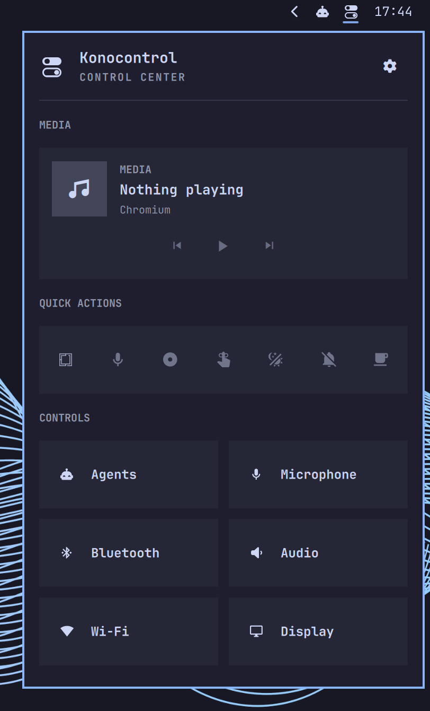

# Konocontrol

A native control center for Omarchy. Part of [Konochi](https://github.com/xvvhang/konochi),
a collection of native Omarchy plugins.

## Screenshot

[](preview.png)

## Features

- Collect built-in bar widgets into one panel, or restore them to the bar.
- Scrollable **Media → Quick Actions → Controls** sections with native actions
  and detail panels.
- Standalone media controls, audio and microphone cards, and compact Menu,
  Indicators, and keyboard-layout actions. Single keyboard layouts auto-hide.
- Escape from a detail panel returns to the control center and restores its
  scroll position; clicking outside dismisses it.
- Collected System Update appears in Quick Actions only when updates are pending;
  its native update indicator also remains visible in the bar while pending.
- Collect the native Elsewhen world clock (`omarchy.elsewhen`) as a **World Clock**
  control, opening its existing city clocks and globe panel without duplicating
  its settings or data sources.

## Installation

Requires **Omarchy Quattro** and its native shell widgets.

```sh
omarchy plugin add https://github.com/xvvhang/omarchy-konocontrol-plugin --enable
```

## Usage

Left-click the bar icon to open the control center. Right-click it, or select
**Configure**, to choose which widgets are collected. Changes save automatically.
Click a control to open its native panel; right-click Microphone to toggle mute.

Only existing, enabled **built-in Omarchy widgets** are supported. Tray and
third-party plugins stay in the bar. Keep collected widgets in `bar.layout`:
Konocontrol moves their existing instances rather than replacing them.

This plugin depends on Omarchy's native shell internals; future shell changes,
vertical bars, and multi-monitor setups may require compatibility updates.

### Album artwork limits

Artwork uses Python 3 (standard library only, no extra packages). When a selected
local MPRIS player supplies a cover URL, the plugin may fetch that URL over HTTPS;
local `file://` artwork is also supported. There is no polling or retry loop.
HTTP, redirects, embedded credentials, nonlocal file URLs, symlinks, non-regular
files and formats other than PNG/JPEG are rejected and show the music placeholder.

Before Qt receives any image, a separate helper caps the encoded input at 2 MiB
(including responses without Content-Length), enforces a 5-second complete-operation
deadline, and checks raster headers against a 4,000,000-pixel / 8192-pixel-side
budget. Qt then decodes the bounded in-memory data URL at display size using
`SizedImage`; the original player URL never reaches Qt's network image loader.
There are no temporary artwork files or download subprocesses. Track/URL changes
clear the previous cover, cancel the helper and discard stale results. A separate
6-second watchdog kills a stuck helper; cancellation escalates to a kill after
100 ms, and component destruction kills the helper immediately.

### World Clock

On shells with Elsewhen, keep `omarchy.elsewhen` enabled in `bar.layout` and
choose **Configure → World Clock → Control center**. Click its card to open the
native panel. Escape first unwinds the clock's own search, shifted time or globe
view; when the panel closes through Escape, it returns to the control center.
Switch the placement back to **Bar** to restore the original world-clock button.

World Clock is included in the default collection for new configurations only;
existing saved placement choices are preserved. Shells without Elsewhen simply
omit it. City settings and any network requests remain managed by the native
widget; see Omarchy's world-clock documentation for its data sources.

### Omarchy RC compatibility

Supports the split `ModuleSlot` / `WidgetHost` bar layout in Omarchy 4.5.0rc3
as well as the earlier combined slots. Collected widgets release their bar
layout space and restore their original loader anchors when returned to Bar.
Quick Actions follows the native indicator list rather than hardcoding removed
indicators; available actions depend on the installed Omarchy version.

If an update still shows an empty control center, run `omarchy restart shell`
once: plugin rescanning can retain cached QML components.

Discovery regression checks (development only, requires Node.js):

```sh
node test_compat.cjs
python3 -B test_artwork.py
omarchy plugin validate .
```

Artwork tests require `openssl` to create an ephemeral certificate for a local
TLS test server. They cover ordinary art, announced and chunked oversized responses,
below-idle-timeout trickles, cancellation/connection cleanup, local file checks,
pixel budgets, unsupported URLs and redirects. They contact no public services.

## Removal

In **Configure**, switch collected widgets back to **Bar**, then run:

```sh
omarchy plugin remove konochi.konocontrol
```

## License

[MIT](LICENSE). Built for [Omarchy](https://omarchy.org/) and
[Quickshell](https://quickshell.org/); an independent community plugin.
