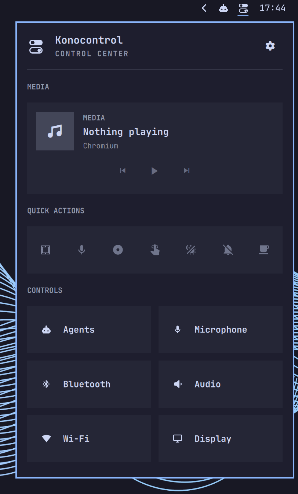

# Konocontrol

A native control center for Omarchy. Part of [Konochi](https://github.com/xvvhang/konochi),
a collection of native Omarchy plugins.

## Screenshot

[](preview.png)

## Features

- Collect built-in bar widgets into one panel, or restore them to the bar.
- Scrollable **Media → Quick Actions → Controls** sections with native actions
  and detail panels.
- Standalone media controls, audio and microphone cards, and compact Menu,
  Indicators, and keyboard-layout actions. Single keyboard layouts auto-hide.
- Escape from a detail panel returns to the control center and restores its
  scroll position; clicking outside dismisses it.

## Installation

Requires **Omarchy Quattro** and its native shell widgets.

```sh
omarchy plugin add https://github.com/xvvhang/omarchy-konocontrol-plugin --enable
```

## Usage

Left-click the bar icon to open the control center. Right-click it, or select
**Configure**, to choose which widgets are collected. Changes save automatically.
Click a control to open its native panel; right-click Microphone to toggle mute.

Only existing, enabled **built-in Omarchy widgets** are supported. Tray and
third-party plugins stay in the bar. Keep collected widgets in `bar.layout`:
Konocontrol moves their existing instances rather than replacing them.

This plugin depends on Omarchy's native shell internals; future shell changes,
vertical bars, and multi-monitor setups may require compatibility updates.

## License

[MIT](LICENSE). Built for [Omarchy](https://omarchy.org/) and
[Quickshell](https://quickshell.org/); an independent community plugin.
